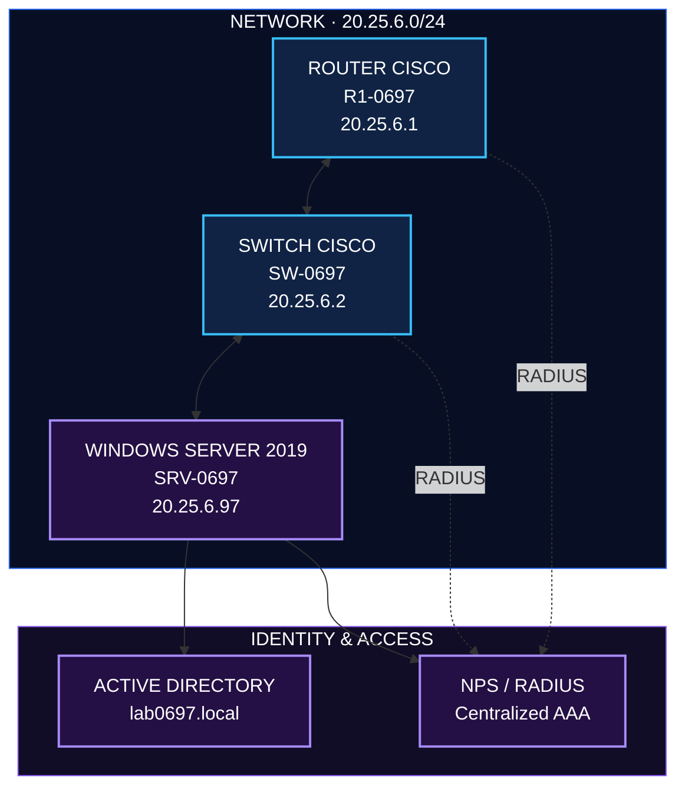
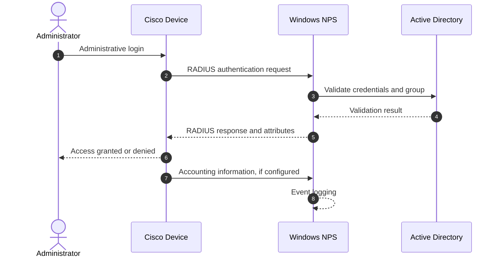
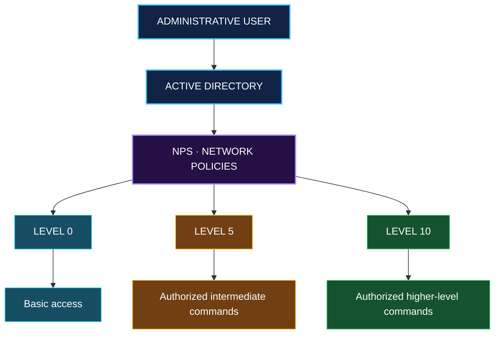

<div align="center">


# 🔐 AAA · RADIUS · NPS

### Centralized Authentication & Access Control

**Cisco IOS · Windows Server 2019 · Active Directory**

<br>

<a href="https://www.youtube.com/watch?v=AUIDbIU_O54">

</a>

<br><br>


<br><br>

**EMELY CARRASCO**

*Estudiante de Seguridad Informática · ITLA*

`DETECT` &nbsp; ◆ &nbsp; `ANALYZE` &nbsp; ◆ &nbsp; `DOCUMENT`

</div>

---

<div align="center">

| 🔵 AUTHENTICATION | 🟣 AUTHORIZATION | 🟢 ACCOUNTING |
|:---:|:---:|:---:|
| Identity verification | Privilege management | Activity logging |

</div>

# 01 · Overview

## 🎯 Propósito del laboratorio

Implementar una infraestructura de autenticación, autorización y registro de actividad (**AAA**) que centralice la administración de accesos a dispositivos Cisco mediante RADIUS, Windows Server 2019, Active Directory y Network Policy Server (NPS).

El laboratorio contempla tres niveles de privilegio —**0, 5 y 10**— asociados a grupos de seguridad, así como el acceso administrativo mediante SSH v2, la configuración de usuarios locales de respaldo y la revisión de registros.

### Objetivos

- Centralizar la autenticación de usuarios mediante RADIUS y NPS.
- Integrar Active Directory con las políticas de acceso de los dispositivos.
- Aplicar niveles de privilegio mediante el atributo `Cisco-AV-Pair`.
- Configurar acceso administrativo mediante SSH v2.
- Documentar los mecanismos de respaldo local y registro de actividad.
- Validar los resultados mediante pruebas técnicas y evidencias.

---

# 02 · Technology Stack

<div align="center">

| Tecnología | Función |
|:---|:---|
| 🔵 **Cisco IOS 15.2** | Administración del router y switch |
| 🔷 **Windows Server 2019** | Plataforma de servicios |
| 🟣 **Active Directory DS** | Gestión de usuarios y grupos |
| 🟪 **NPS / RADIUS** | Autenticación y autorización centralizadas |
| 🟢 **SSH v2** | Administración remota segura |
| ⚙️ **DNS** | Resolución de nombres del dominio |
| 💻 **PuTTY** | Pruebas de conexión SSH |
| 📋 **Visor de eventos** | Revisión de registros |

</div>

---

# 03 · Network Architecture

## 🗺️ Topología original

<div align="center">


*Topología original de la infraestructura.*

</div>

## 🌐 Diagrama lógico



*Diagrama lógico de referencia; las conexiones deben verificarse con las evidencias de conectividad.*

## 📡 Plan de direccionamiento

| Dispositivo | Interfaz | Dirección IP |
|:---|:---|:---|
| R1-0697 | Gi1/0 | `20.25.6.1/24` |
| SW-0697 | VLAN 97 | `20.25.6.2/24` |
| SRV-0697 | Ethernet0 2 | `20.25.6.97/24` |

**Red:** `20.25.6.0/24` · **Gateway:** `20.25.6.1`

📄 [Documentación de arquitectura](docs/03-arquitectura.md)

---

# 04 · AAA Workflow

## 🔄 Flujo de autenticación



> El flujo representa el funcionamiento lógico previsto. La autorización efectiva y el registro de sesiones dependen de las políticas y de la configuración aplicada.

## 🛡️ Privilege Levels



Los comandos permitidos dependen de la configuración efectiva de cada dispositivo y de las pruebas realizadas.

---

# 05 · Infrastructure Components

<details>
<summary><strong>🔵 R1-0697 · Cisco Router</strong></summary>

- Configuración AAA con RADIUS mediante `GRP-NPS`.
- Usuario local `admin0697`.
- Configuración de `enable secret`.
- Autenticación en las líneas de consola, auxiliar y VTY.
- Acceso SSH v2.
- Niveles de privilegio.
- Registros de autenticación y actividad.

📄 [Configuración del router](docs/04-configuracion-router.md)

</details>

<details>
<summary><strong>🩵 SW-0697 · Cisco Switch</strong></summary>

- Configuración AAA y RADIUS.
- VLAN 97 para administración.
- Usuario local `admin0697`.
- Acceso SSH v2 y claves RSA.
- Niveles de privilegio.
- Registros de actividad.

📄 [Configuración del switch](docs/05-configuracion-switch.md)

</details>

<details>
<summary><strong>🟣 SRV-0697 · Windows Server 2019</strong></summary>

**Active Directory**
- Dominio `lab0697.local`.
- Grupos `GRP-Nivel-0`, `GRP-Nivel-5` y `GRP-Nivel-10`.
- Usuarios `usr-nivel0`, `usr-nivel5` y `usr-nivel10`.

**Network Policy Server**
- Clientes RADIUS para router y switch.
- Directivas `POL-Nivel-0`, `POL-Nivel-5` y `POL-Nivel-10`.
- Atributo `Cisco-AV-Pair`.
- Registros y evidencias de autenticación.

📄 [Active Directory](docs/06-active-directory.md) · [Configuración de NPS](docs/07-configuracion-nps.md)

</details>

---

# 06 · Technical Documentation

| ID | Documento | Descripción |
|:---:|:---|:---|
| `01` | [Introducción](docs/01-introduccion.md) | Propósito y tecnologías |
| `02` | [Objetivos y alcance](docs/02-objetivos-y-alcance.md) | Objetivos y límites |
| `03` | [Arquitectura](docs/03-arquitectura.md) | Topología y direccionamiento |
| `04` | [Configuración del router](docs/04-configuracion-router.md) | AAA y privilegios |
| `05` | [Configuración del switch](docs/05-configuracion-switch.md) | SSH y AAA |
| `06` | [Active Directory](docs/06-active-directory.md) | Usuarios y grupos |
| `07` | [Configuración de NPS](docs/07-configuracion-nps.md) | Clientes y políticas |
| `08` | [Pruebas y validación](docs/08-pruebas-y-validacion.md) | Verificaciones técnicas |
| `09` | [Resultados](docs/09-resultados.md) | Resultados obtenidos |
| `10` | [Estado e inventario](docs/12-estado-e-inventario.md) | Archivos y estado del proyecto |

---

# 07 · Configurations & Scripts

| Componente | Archivo |
|:---|:---|
| 🔵 Router | [`configs/router/running-config.txt`](configs/router/running-config.txt) |
| 🔵 Router · versión inicial | [`configs/router/historial/running-config_v1-inicial.txt`](configs/router/historial/running-config_v1-inicial.txt) |
| 🩵 Switch | [`configs/switch/running-config.txt`](configs/switch/running-config.txt) |
| 🩵 Switch · versión inicial | [`configs/switch/historial/running-config_v1-inicial.txt`](configs/switch/historial/running-config_v1-inicial.txt) |
| 🟣 Servidor | [`configs/server/README.md`](configs/server/README.md) |
| ⚙️ Scripts y notas | [`scripts/README.md`](scripts/README.md) |
| 📁 Inventario | [`configs/README.md`](configs/README.md) |

Las configuraciones publicadas son copias sanitizadas. Los hashes y la clave compartida RADIUS se sustituyeron por marcadores.

---

# 08 · Evidence & Validation

## 🖼️ Evidencias técnicas

| Carpeta | Contenido |
|:---|:---|
| [`diagrams/`](diagrams/) | Topología original |
| [`images/router/`](images/router/) | Pruebas del router |
| [`images/switch/`](images/switch/) | Pruebas del switch |
| [`images/active-directory/`](images/active-directory/) | Usuarios y grupos |
| [`images/nps/`](images/nps/) | Directivas y eventos 6272 |
| [`images/servidor/`](images/servidor/) | Información del servidor |
| [`evidence/ssh/`](evidence/ssh/) | Evidencias SSH |
| [`evidence/radius-logs/`](evidence/radius-logs/) | Registros RADIUS |

📄 [Inventario de evidencias](docs/12-estado-e-inventario.md#inventario-de-materiales)

## 📊 Resultados principales

- El router aplica los niveles 0, 5 y 10 por consola y SSH.
- El switch otorga los niveles 0, 5 y 10 por SSH.
- NPS autentica contra Active Directory y entrega `priv-lvl` según el grupo.
- Los eventos 6272 y el estado de RADIUS se encuentran documentados.


📄 [Resultados completos](docs/09-resultados.md) ·

---

# 09 · Security Considerations

<div align="center">


</div>

- No se publican contraseñas ni claves compartidas reales.
- Los marcadores `<HASH_SECRET_REDACTADO>` y `<RADIUS_SHARED_SECRET_REDACTADO>` sustituyen los valores reales.
- Los archivos publicados contienen copias sanitizadas.
- Los originales se conservan fuera del repositorio.

La documentación distingue entre las funciones implementadas, las pruebas demostradas y los aspectos que todavía requieren revisión.

---

# 10 · Repository Structure

```text
.
├── README.md
├── CHANGELOG.md
├── docs/
├── diagrams/
├── images/
│   ├── router/
│   ├── switch/
│   ├── active-directory/
│   ├── nps/
│   └── servidor/
├── configs/
│   ├── router/
│   ├── switch/
│   └── server/
├── scripts/
├── evidence/
│   ├── ssh/
│   └── radius-logs/
└── demo/
```


<div align="center">

---


## 👩‍💻 Emely Carrasco

**Estudiante de Seguridad Informática · ITLA**

*Fundamento de seguridad de redes · 29/10/2026*

<br>

### `DETECT` · `ANALYZE` · `DOCUMENT`

*Aprendiendo seguridad informática mediante la práctica, la documentación y la validación técnica.*

</div>
