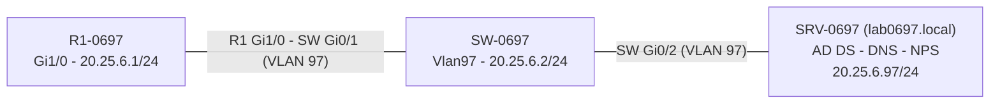

# 03 – Arquitectura y topología

## Topología original

*Captura original del emulador: R1 ↔ SW ↔ WINDOWSSERVER. Se conserva sin modificar.*

## Diagrama lógico

*Diagrama elaborado a partir de las descripciones de interfaz del running-config. El puerto de R1 (Gi1/0) tiene la descripción `Enlace a SW-0697`; la NIC del servidor es `Ethernet0 2` (Intel PRO/1000 MT).*

## Plan de direccionamiento

| Dispositivo | Interfaz | IP | Máscara | Notas |
|---|---|---|---|---|
| R1-0697 | GigabitEthernet1/0 | 20.25.6.1 | 255.255.255.0 | `ip radius source-interface Gi1/0` |
| SW-0697 | Vlan97 | 20.25.6.2 | 255.255.255.0 | Gateway 20.25.6.1 |
| SRV-0697 | Ethernet0 2 | 20.25.6.97 | 255.255.255.0 | Gateway 20.25.6.1, DNS 20.25.6.97 ([`ipconfig /all`](../images/servidor/srv-ipconfig-y-version.png)) |

## Puertos del switch

| Puerto | Descripción | Modo | VLAN |
|---|---|---|---|
| Gi0/1 | `Enlace a R1-0697` | access | 97 |
| Gi0/2 | `Enlace a SRV-0697` | access | 97 |

Los demás puertos no tienen configuración específica.
