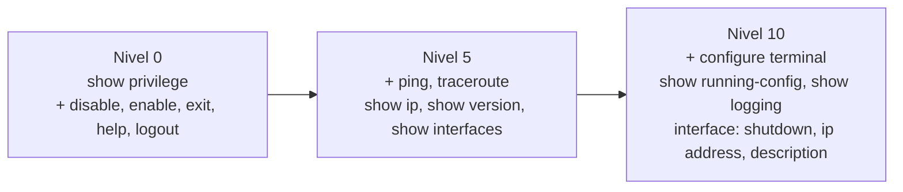

# 04 – Configuración del router R1-0697

Fuente: [`configs/router/running-config.txt`](../configs/router/running-config.txt) (sanitizado, versión actual) y [`evidence/ssh/show-ip-ssh-r1-0697.txt`](../evidence/ssh/show-ip-ssh-r1-0697.txt). La versión anterior se conserva en [`configs/router/historial/`](../configs/router/historial/).

| Dato | Valor |
|---|---|
| Hostname / dominio | `R1-0697` / `lab0697.local` |
| Versión IOS | 15.2 |
| Interfaz activa | Gi1/0 (`Enlace a SW-0697`) – 20.25.6.1/24 (Fa0/0 en `shutdown`) |
| Último cambio de configuración | 05:39:21 UTC, mié 28-oct-2026, por `usr-nivel10` (captura del 28-oct; la recaptura final del 29-oct tiene el mismo contenido y no incluye esa línea) |

## 1. Usuario local y enable

```text
username admin0697 privilege 15 secret 5 <HASH_SECRET_REDACTADO>
enable secret 5 <HASH_SECRET_REDACTADO>
```

`admin0697` es el respaldo local. Además `service password-encryption` está activo.

## 2. AAA

| Función | Lista | Métodos |
|---|---|---|
| Autenticación login | `default` | `local` |
| Autenticación login | `LOGIN-NPS` | `group GRP-NPS` → `local` |
| Autenticación enable | `default` | `enable` |
| Autorización | consola | habilitada (`aaa authorization console`) |
| Autorización exec | `default` | `local` |
| Autorización exec | `EXEC-NPS` | `group GRP-NPS` → `local` |
| Accounting exec | `ACCT-NPS` | `start-stop group GRP-NPS` |
| Accounting connection / system | `default` | `start-stop group GRP-NPS` |

> En IOS el método `local` solo se usa como respaldo cuando el servidor RADIUS **no responde**; un rechazo explícito (Access-Reject) no pasa al siguiente método. Por eso `admin0697` no inicia sesión mientras NPS esté disponible ([08](08-pruebas-y-validacion.md#8-registros-de-autenticación-sec_login)).

## 3. RADIUS (cliente)

```text
aaa group server radius GRP-NPS
 server name NPS-0697
!
radius server NPS-0697
 address ipv4 20.25.6.97 auth-port 1812 acct-port 1813
 timeout 3
 retransmit 2
 key 7 <RADIUS_SHARED_SECRET_REDACTADO>
!
ip radius source-interface GigabitEthernet1/0
```

> **Cambio respecto a la versión anterior:** antes el router usaba `radius-server host … key 7 …` y `group radius`; ahora usa un servidor y un grupo nombrados, igual que el switch.

La dirección de origen (20.25.6.1) coincide con el cliente `R1-0697` registrado en NPS ([captura](../images/nps/nps-clientes-radius.png)).

## 4. Líneas de acceso

| Línea | Autenticación | Autorización exec | Accounting | Otros |
|---|---|---|---|---|
| `con 0` | `LOGIN-NPS` | `EXEC-NPS` | `ACCT-NPS` | `exec-timeout 5 0`, `logging synchronous` |
| `aux 0` | `LOGIN-NPS` | `EXEC-NPS` | `ACCT-NPS` | `exec-timeout 5 0`, `logging synchronous` |
| `vty 0 4` | `LOGIN-NPS` | `EXEC-NPS` | `ACCT-NPS` | `exec-timeout 5 0`, `transport input ssh` |

## 5. SSH

```text
ip domain name lab0697.local
ip ssh version 2
ip ssh time-out 60
```

`show ip ssh` confirma **«SSH Enabled – version 2.0»** con clave RSA generada, 3 reintentos y *timeout* de 60 s. Las sesiones PuTTY se muestran en [08](08-pruebas-y-validacion.md#4-acceso-ssh-desde-srv-0697-a-r1).

Servicios deshabilitados: `no ip http server`, `no ip http secure-server`, `no ip domain lookup`.

## 6. Registros y protección de acceso

```text
service timestamps log datetime msec
logging buffered 64000 informational
logging console informational
login block-for 120 attempts 3 within 60
login on-failure log
login on-success log
```

Generan los mensajes `%SEC_LOGIN-4-LOGIN_FAILED` y `%SEC_LOGIN-5-LOGIN_SUCCESS` visibles en las [capturas de consola](08-pruebas-y-validacion.md#2-acceso-por-consola-a-r1). El *accounting* AAA se envía a RADIUS.

## 7. Niveles de privilegio

Los niveles se asignan localmente con `privilege …`; NPS entrega el nivel con el atributo `Cisco-AV-Pair` `shell:priv-lvl=N` según el grupo del usuario ([07](07-configuracion-nps.md#directivas-de-red)).



| Nivel | Comandos definidos en el running-config |
|---|---|
| 0 | `show` (palabra clave) y `show privilege` |
| 5 | `ping`, `traceroute`, `show ip`, `show ip interface [brief]`, `show version`, `show interfaces` |
| 10 | `configure` / `configure terminal`, `show running-config`, `show logging`; modo `interface` y, dentro de él, `shutdown`, `ip`, `ip address`, `description` |

Los niveles 5 y 10 además conservan los comandos que IOS deja por defecto en el nivel 1 (visible en el listado de `?` de las capturas del nivel 5 y 10).

## Observaciones

Ver [H4](10-problemas-y-soluciones.md): las líneas VTY también usan NPS. Los hallazgos H2 (sin `enable secret`) y H5 (sin `login block-for`) de la versión anterior quedaron **corregidos**.
