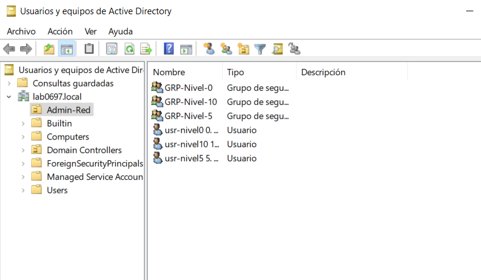
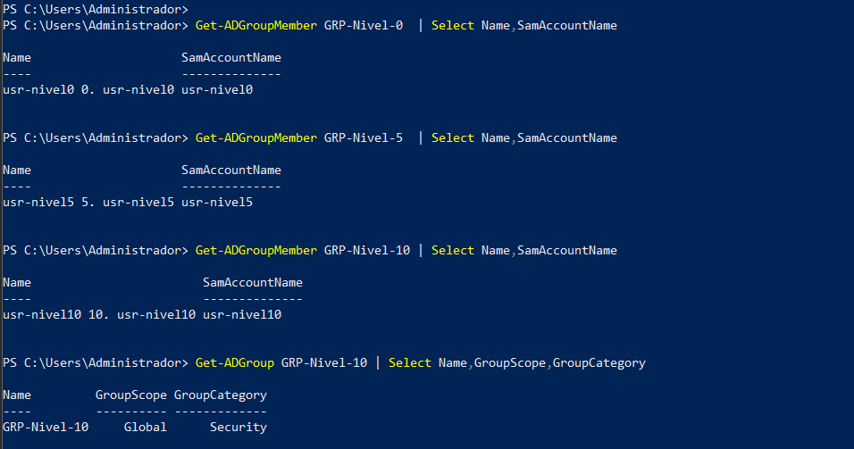
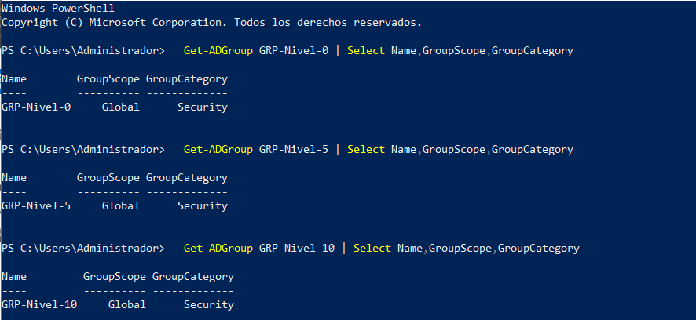

# 06 – Active Directory

*Consola «Usuarios y equipos de Active Directory»: dominio `lab0697.local`, unidad organizativa `Admin-Red`.*

## Datos observados

| Elemento | Valor | Evidencia |
|---|---|---|
| Dominio | `lab0697.local` | Captura AD |
| Servidor | `SRV-0697.lab0697.local` (Windows Server 2019 Standard Evaluation, 10.0.17763) | [`ipconfig` / `Get-ComputerInfo`](../images/servidor/srv-ipconfig-y-version.png) |
| Unidad organizativa | `Admin-Red` | Captura AD |

## Grupos de seguridad (nivel 0, 5 y 10) y membresía

*Salida de `Get-ADGroupMember` para cada grupo y `Get-ADGroup` para `GRP-Nivel-10`.*

| Grupo | Miembro (`SamAccountName`) | Nivel de privilegio |
|---|---|---|
| `GRP-Nivel-0` | `usr-nivel0` | 0 |
| `GRP-Nivel-5` | `usr-nivel5` | 5 |
| `GRP-Nivel-10` | `usr-nivel10` | 10 |

Los tres grupos son de ámbito **Global** y categoría **Security**:

*Salida de `Get-ADGroup` para `GRP-Nivel-0`, `GRP-Nivel-5` y `GRP-Nivel-10`.*

Cada grupo tiene un único usuario y cada usuario pertenece solo al grupo de su nivel (según los resultados mostrados).

## Datos no evidenciados

- Directiva de contraseñas de dominio.

Ver [docs/10](10-problemas-y-soluciones.md#datos-faltantes).
