# 07 – Configuración de NPS y autenticación RADIUS

El servidor `SRV-0697` ejecuta el rol **Servicios de acceso y directivas de redes (NPAS/NPS)**, visible en el Administrador del servidor de las capturas de PuTTY.

## Servidor

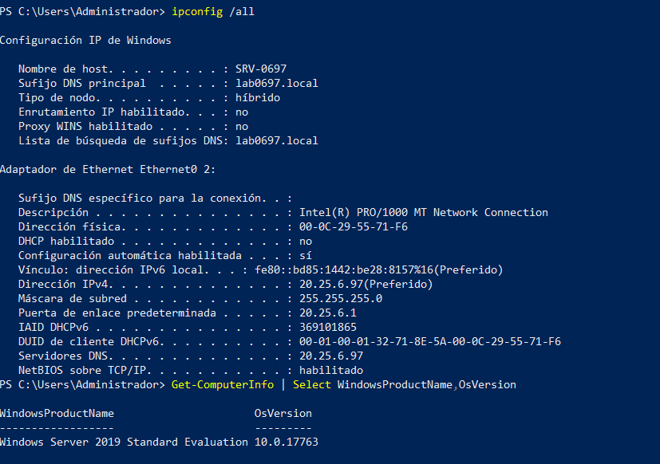

| Dato | Valor |
|---|---|
| Hostname / sufijo DNS | `SRV-0697` / `lab0697.local` |
| Sistema operativo | Windows Server 2019 Standard Evaluation (10.0.17763) |
| Adaptador | `Ethernet0 2` – Intel(R) PRO/1000 MT |
| IPv4 | 20.25.6.97 / 255.255.255.0, DHCP deshabilitado |
| Gateway / DNS | 20.25.6.1 / 20.25.6.97 |

## Clientes RADIUS

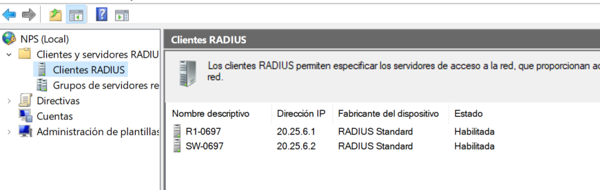

| Nombre | IP | Fabricante | Estado |
|---|---|---|---|
| R1-0697 | 20.25.6.1 | RADIUS Standard | Habilitada |
| SW-0697 | 20.25.6.2 | RADIUS Standard | Habilitada |

Puertos usados por los equipos: **1812** (autenticación) y **1813** (*accounting*). El *shared secret* no se publica.

## Directivas de red

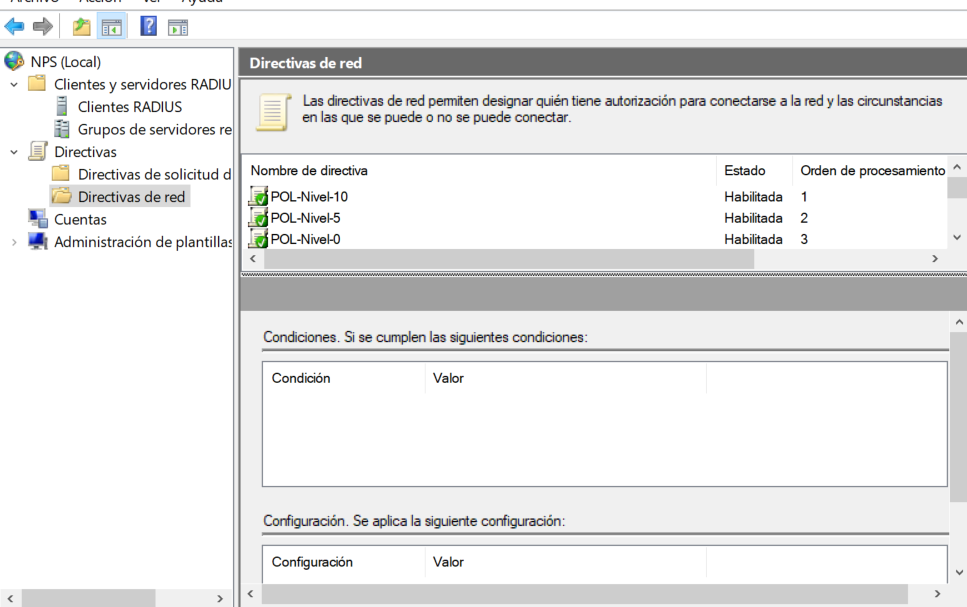

| Orden | Directiva | Estado | Condición | Atributo estándar | Atributo específico del proveedor |
|---|---|---|---|---|---|
| 1 | `POL-Nivel-10` | Habilitada | Grupos de Windows = `LAB0697\GRP-Nivel-10` | `Service-Type` = `Login` | `Cisco-AV-Pair` = `shell:priv-lvl=10` |
| 2 | `POL-Nivel-5` | Habilitada | Grupos de Windows = `LAB0697\GRP-Nivel-5` | `Service-Type` = `Login` | `Cisco-AV-Pair` = `shell:priv-lvl=5` |
| 3 | `POL-Nivel-0` | Habilitada | Grupos de Windows = `LAB0697\GRP-Nivel-0` | `Service-Type` = `Login` | `Cisco-AV-Pair` = `shell:priv-lvl=0` |

Así se entrega el nivel de privilegio: cada directiva se activa por pertenencia a grupo y envía al equipo el atributo `Cisco-AV-Pair` con el nivel correspondiente. Si un usuario perteneciera a varios grupos, NPS aplicaría la primera directiva que coincida según el orden (10 → 5 → 0).

### POL-Nivel-10

| Condiciones | Atributo estándar | Cisco-AV-Pair |
|---|---|---|
| 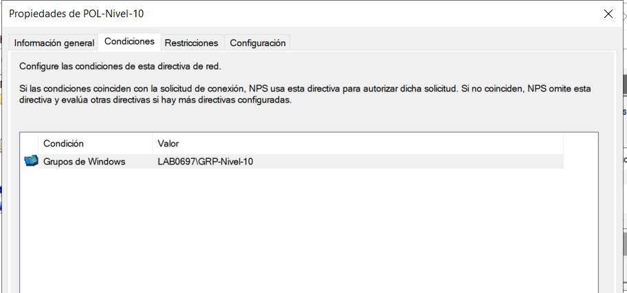 | 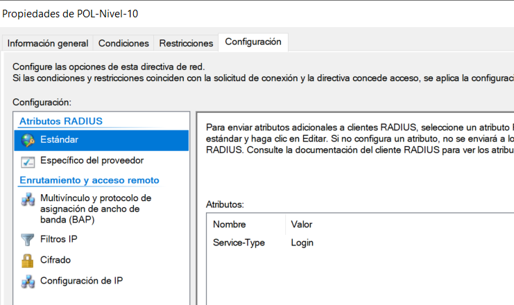 | 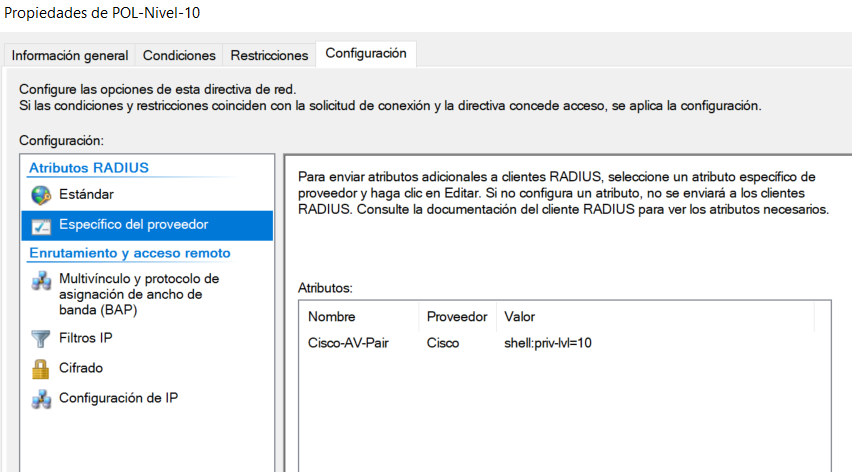 |

### POL-Nivel-5

| Condiciones | Atributo estándar | Cisco-AV-Pair |
|---|---|---|
| 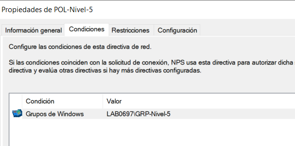 | 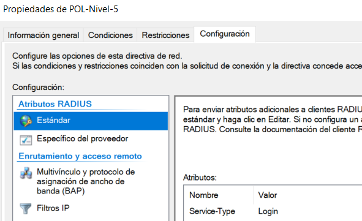 | 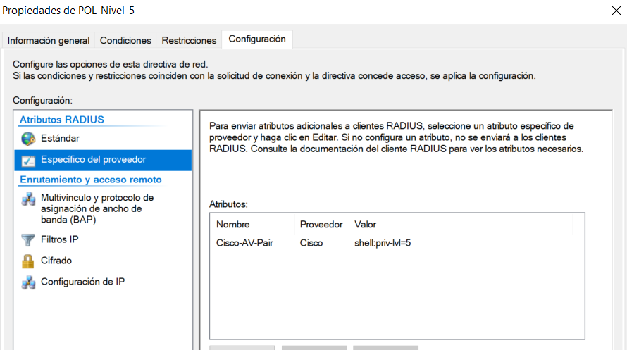 |

### POL-Nivel-0

| Condiciones | Atributo estándar | Cisco-AV-Pair |
|---|---|---|
| 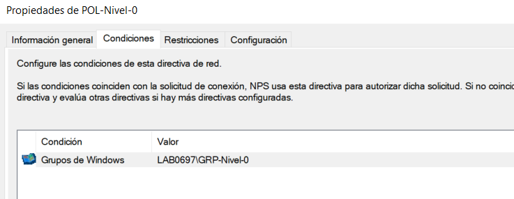 | 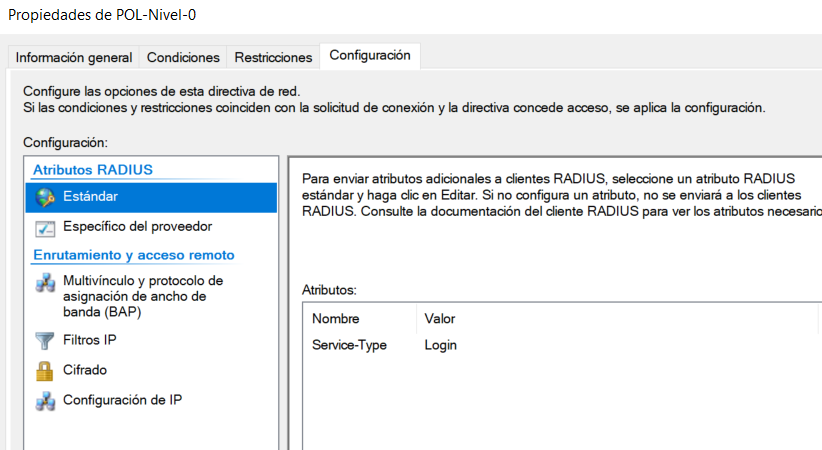 | 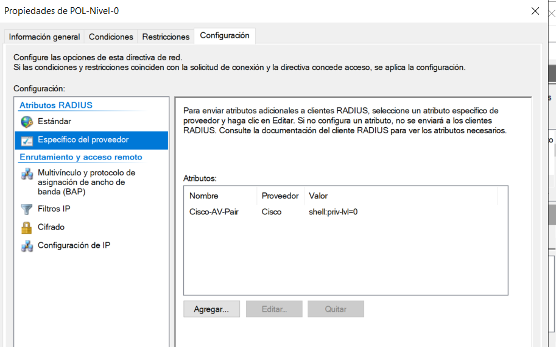 |

> **No capturado:** las pestañas «Información general» (tipo de permiso de acceso) y «Restricciones» (métodos de autenticación) de cada directiva, y las directivas de solicitud de conexión. Ver [docs/10](10-problemas-y-soluciones.md#datos-faltantes).

## Flujo AAA

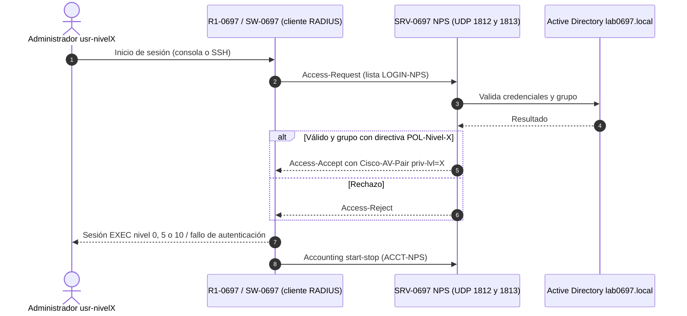

*Diagrama conceptual basado en configuraciones y capturas.*

## Registros de auditoría de NPS

NPS registra en el Visor de eventos (Seguridad) los eventos **6272** (acceso concedido) y **6273** (acceso denegado). Las evidencias de 6272 para los tres usuarios están en [08](08-pruebas-y-validacion.md#3-eventos-de-nps). Los contadores RADIUS de los equipos están en [08](08-pruebas-y-validacion.md#7-contadores-radius-show-aaa-servers).

