# 08 – Pruebas y validación

Solo se documentan resultados **visibles en las capturas y archivos entregados**. Fecha de las pruebas: 27/28-oct-2026. Los equipos de red registran en UTC.

## 1. Resumen

| ID | Prueba | Resultado observado | Evidencia |
|---|---|---|---|
| T1 | Consola R1 – `usr-nivel0` | Acceso concedido (tras un primer intento fallido); nivel 0; `ping` y `show running-config` rechazados | [Fig. 5](../images/router/consola-r1-usr-nivel0.png) |
| T2 | Consola R1 – `usr-nivel5` | Acceso concedido; nivel 5; `show running-config` y `configure terminal` rechazados | [Fig. 6](../images/router/consola-r1-usr-nivel5.png) |
| T3 | Consola R1 – `usr-nivel10` | Acceso concedido; nivel 10; `reload` y `debug` rechazados | [Fig. 7](../images/router/consola-r1-usr-nivel10.png) |
| T4 | SSH a R1 (20.25.6.1) desde SRV | Los 3 usuarios inician sesión (prompt `>` / `#` / `#`) | [Fig. 8](../images/router/ssh-putty-r1-usr-nivel0.png), [Fig. 9](../images/router/ssh-putty-r1-usr-nivel5.png), [Fig. 10](../images/router/ssh-putty-r1-usr-nivel10.png) |
| T5 | Auditoría en NPS | Eventos 6272 para los 3 usuarios; 6273 también presentes | [Fig. 11](../images/nps/nps-evento-6272-usr-nivel0.png), [Fig. 12](../images/nps/nps-evento-6272-usr-nivel5.png), [Fig. 13](../images/nps/nps-evento-6272-usr-nivel10.png) |
| T6 | `show ip ssh` en R1 | SSH habilitado v2.0, clave RSA presente | [archivo](../evidence/ssh/show-ip-ssh-r1-0697.txt) |
| T7 | `show ip ssh` en SW (antes) | SSH deshabilitado, sin claves RSA | [archivo](../evidence/ssh/show-ip-ssh-sw-0697-antes.txt) |
| T8 | `show ip ssh` en SW (después) | SSH habilitado v2.0 con clave RSA | [archivo](../evidence/ssh/show-ip-ssh-sw-0697-despues.txt) |
| T9 | `show aaa servers` en R1 y SW | Servidor RADIUS 20.25.6.97 *UP* en ambos | [R1](../evidence/radius-logs/show-logging-y-aaa-servers-r1-0697.txt), [SW](../evidence/radius-logs/show-logging-y-aaa-servers-sw-0697.txt) |
| T10 | `show logging \| include SEC_LOGIN` en R1 y SW | Intentos fallidos registrados; ver sección 8 | mismos archivos |
| T11 | SSH a R1 – `usr-nivel5` ejecuta `ping 20.25.6.2` | Éxito 80 % (4/5) | [Fig. 29](../images/router/ssh-r1-usr-nivel5-ping.png) |
| T12 | SSH a R1 – `usr-nivel10`: `config t` y `show run` | `config t` aceptado; `show run` devuelve una configuración reducida (280 bytes) | [Fig. 28](../images/router/ssh-r1-usr-nivel10-config-y-show-run.png) |
| T13 | SSH a SW (20.25.6.2) – `usr-nivel0` | Inicio de sesión; `show privilege` → 0 | [Fig. 25](../images/switch/ssh-sw-usr-nivel0-show-privilege.png) |
| T14 | SSH a SW – `usr-nivel10` | Inicio de sesión; `configure terminal` aceptado | [Fig. 26](../images/switch/ssh-sw-usr-nivel10-configure-terminal.png) |
| T15 | SW – `usr-nivel10`: `show running-config` | Configuración reducida (706 bytes) | [Fig. 27](../images/switch/sw-usr-nivel10-show-running-config.png) |
| T16 | SSH a SW – `usr-nivel0` (29-oct): `ping` y `show run` | Ambos rechazados; `show privilege` → 0 | [Fig. 30](../images/switch/ssh-sw-usr-nivel0-login-y-ping-rechazado.png), [Fig. 31](../images/switch/ssh-sw-usr-nivel0-show-run-rechazado.png) |
| T17 | SW – nivel 5: `show privilege` y `ping` | Nivel 5; `ping` 5/5 | [Fig. 32](../images/switch/sw-nivel5-show-privilege-y-ping.png) |
| T18 | SSH a SW – `usr-nivel10` (29-oct): inicio de sesión | Primer intento *Access denied*; segundo correcto | [Fig. 33](../images/switch/ssh-sw-usr-nivel10-login-con-primer-intento-denegado.png) |
| T19 | SW – nivel 10: `ping`, `show run`, `config t` | `ping` 5/5; configuración reducida (706 bytes); nivel 10; `config t` aceptado | [Fig. 34](../images/switch/sw-nivel10-ping-show-run-y-config-t.png) |
| T20 | `Get-ADGroup` de los tres grupos | `Global` / `Security` en los tres | [Fig. 35](../images/active-directory/ad-ambito-de-los-grupos.png) |
| T21 | Filtro de puerto UDP 1813 en el servidor | Existe un filtro para UDP 1813 (regla no verificada) | [Fig. 36](../images/servidor/firewall-puerto-udp-1813.png) |

## 2. Acceso por consola a R1

### T1 – `usr-nivel0`
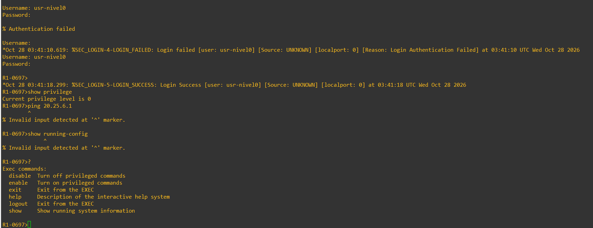

- Primer intento: `% Authentication failed` y `%SEC_LOGIN-4-LOGIN_FAILED` a las 03:41:10 UTC. **La causa no está documentada.**
- Segundo intento: `%SEC_LOGIN-5-LOGIN_SUCCESS` a las 03:41:18 UTC; prompt `R1-0697>`.
- `show privilege` → *Current privilege level is 0*.
- `ping 20.25.6.1` y `show running-config` → *Invalid input detected*.
- `?` solo lista: `disable`, `enable`, `exit`, `help`, `logout`, `show`.

### T2 – `usr-nivel5`
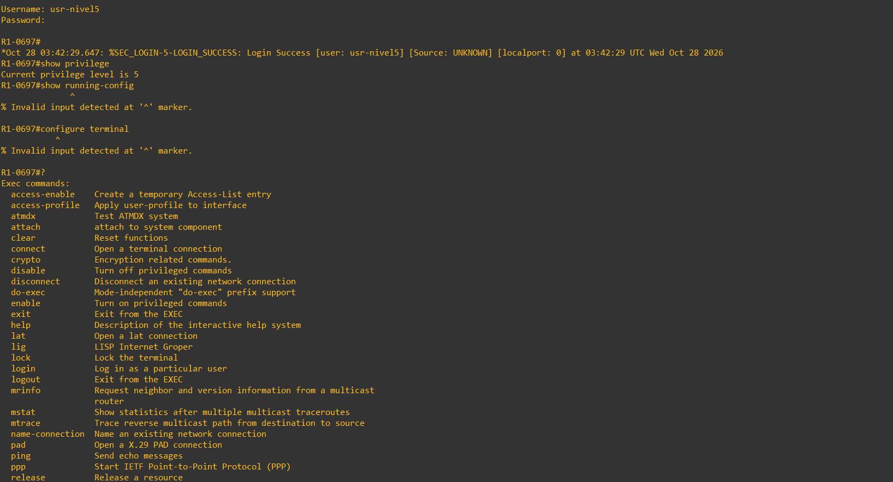

- Inicio de sesión correcto a las 03:42:29 UTC; prompt `R1-0697#`.
- `show privilege` → nivel 5.
- `show running-config` y `configure terminal` → *Invalid input detected*.
- `?` muestra un conjunto más amplio de comandos, incluido `ping` (listado truncado en la captura).
- La ejecución de `ping` en este nivel no aparece en esta captura; se verificó por SSH en [T11](#4-acceso-ssh-desde-srv-0697-a-r1).

### T3 – `usr-nivel10`
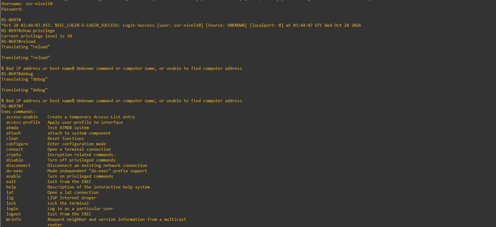

- Inicio de sesión correcto a las 03:44:07 UTC; prompt `R1-0697#`.
- `show privilege` → nivel 10.
- `reload` y `debug` → rechazados (*Unknown command or computer name*).
- `?` incluye `configure`.
- `configure terminal` y `show running-config` no aparecen en esta captura; se verificaron por SSH en [T12](#4-acceso-ssh-desde-srv-0697-a-r1).

## 3. Eventos de NPS

Cada inicio de sesión exitoso tiene su evento **6272** («El servidor de directivas de redes concedió acceso a un usuario») en `SRV-0697.lab0697.local`:

| Usuario | Hora (servidor) | Hora (router, UTC) | Captura |
|---|---|---|---|
| `usr-nivel0` | 4:41:18 | 03:41:18 | 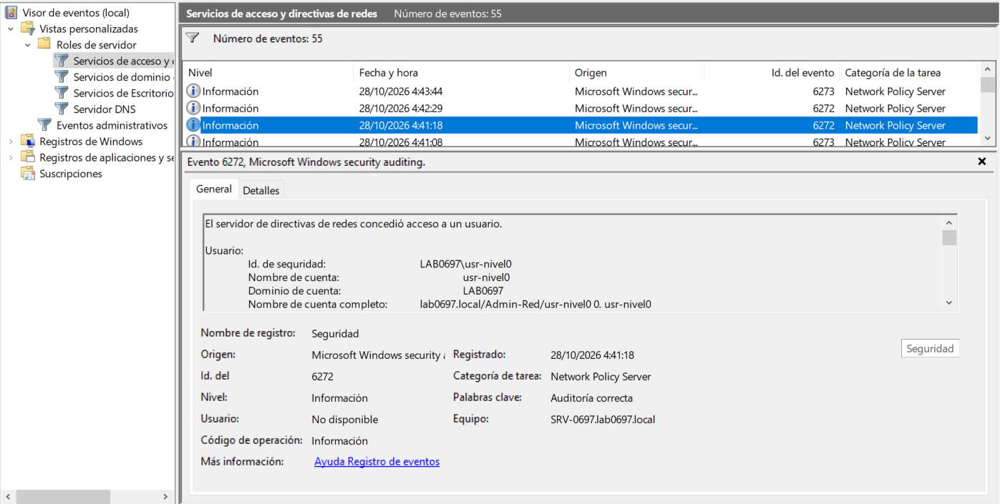 |
| `usr-nivel5` | 4:42:29 | 03:42:29 | 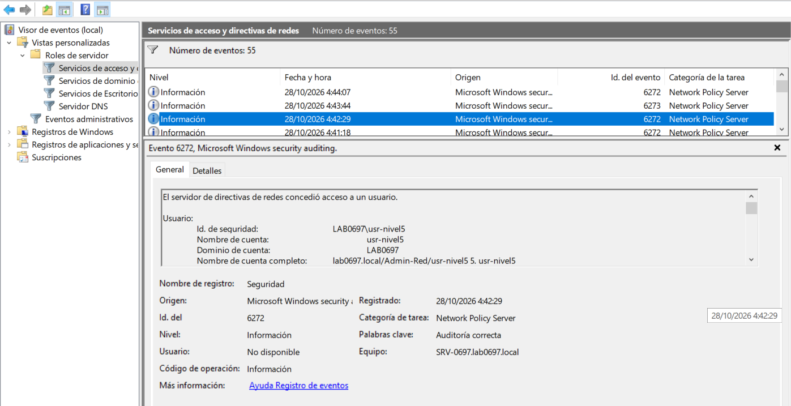 |
| `usr-nivel10` | 4:44:07 | 03:44:07 | 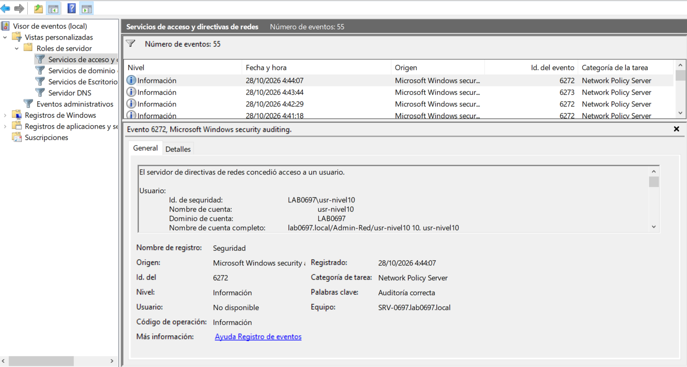 |

El listado del filtro muestra además **eventos 6273 (acceso denegado)** a las 4:41:08 y 4:43:44. El de 4:41:08 coincide en tiempo con el intento fallido de T1; el de 4:43:44 **no puede asociarse a ninguna captura** y no se capturó el detalle de ninguno de los 6273, por lo que sus causas son desconocidas.

> Hay una diferencia de exactamente 1 hora entre el reloj/zona del servidor y los equipos (UTC). La correlación se hizo por coincidencia de minutos y segundos. Ver [H6](10-problemas-y-soluciones.md).

## 4. Acceso SSH desde SRV-0697 a R1

Sesiones PuTTY hacia `20.25.6.1` ejecutadas desde el servidor (se ve el Administrador del servidor de fondo), con autenticación *keyboard-interactive*:

| Usuario | Prompt obtenido | Captura |
|---|---|---|
| `usr-nivel0` | `R1-0697>` | 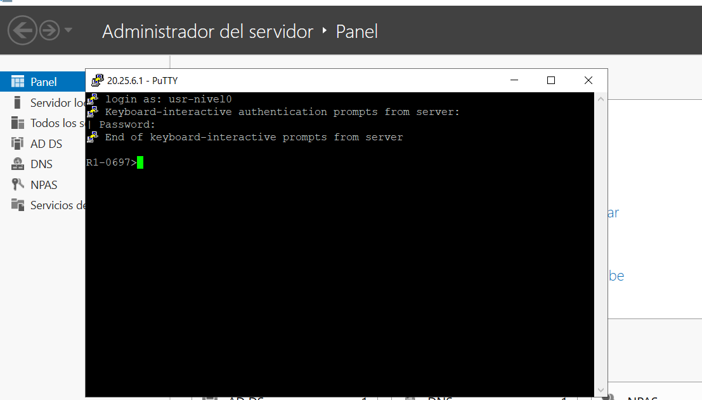 |
| `usr-nivel5` | `R1-0697#` | 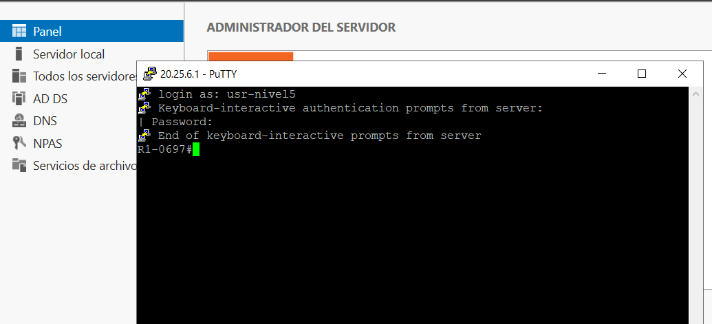 |
| `usr-nivel10` | `R1-0697#` | 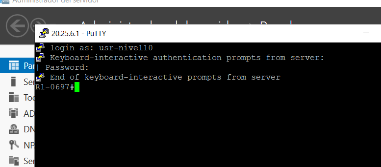 |

Estas tres capturas muestran solo el inicio de sesión. Las siguientes sesiones SSH sí ejecutan comandos:

### T11 – `usr-nivel5`: `ping`
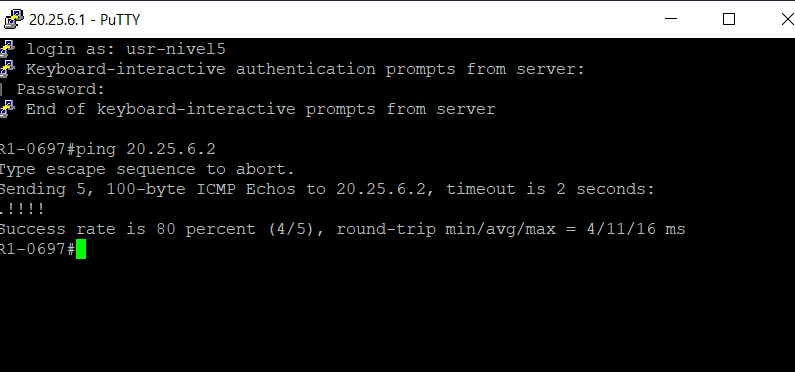

`ping 20.25.6.2` (IP del switch) responde con `.!!!!`: éxito del 80 % (4/5), 4/11/16 ms. Confirma que el nivel 5 puede usar `ping`.

### T12 – `usr-nivel10`: configuración
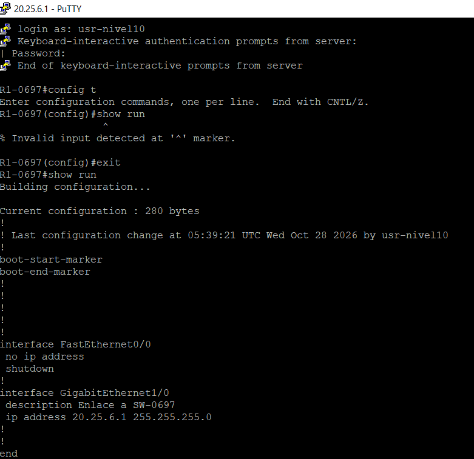

- `config t` es aceptado (el nivel 5 lo tenía rechazado).
- `show run` dentro del modo de configuración → *Invalid input* (se requiere `do show run`).
- Tras `exit`, `show run` muestra una configuración **reducida de 280 bytes** (solo las interfaces), frente a los 2898 bytes de la configuración completa. Es coherente con que IOS limita la salida al nivel de privilegio del usuario, por lo que el nivel 10 no ve la parte AAA/RADIUS.
- El encabezado indica *Last configuration change at 05:39:21 UTC … by usr-nivel10*, igual que el [running-config actual](../configs/router/running-config.txt).

## 5. Estado SSH

- **R1:** `SSH Enabled - version 2.0`, clave `ssh-rsa` presente.
- **SW (antes):** `SSH Disabled` y `%Please create RSA keys to enable SSH`.
- **SW (después):** `SSH Enabled - version 2.0`, clave `ssh-rsa` del host `SW-0697.lab0697.local`. Sesiones PuTTY a `20.25.6.2` con `usr-nivel0` y `usr-nivel10` (sección 6).

## 6. Switch SW-0697

Sesiones SSH desde el servidor a `20.25.6.2` (se observa el *banner* previo a la autenticación del switch). Hay dos tandas de pruebas: 28-oct (T13–T15) y 29-oct (T16–T19).

### T13 – `usr-nivel0` (28-oct)
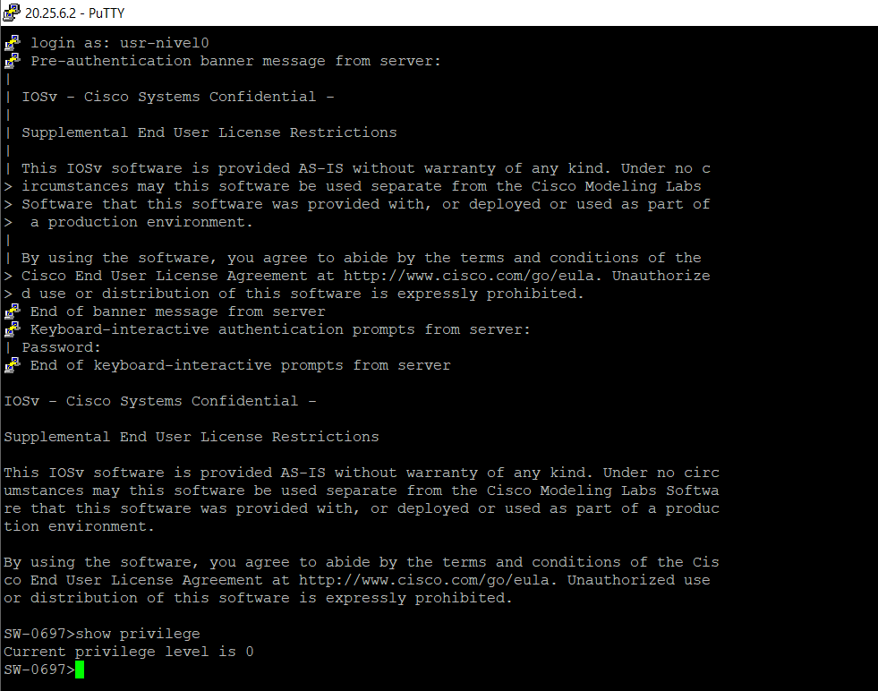

`show privilege` → *Current privilege level is 0*; prompt `SW-0697>`.

### T16 – `usr-nivel0`: comandos rechazados (29-oct)
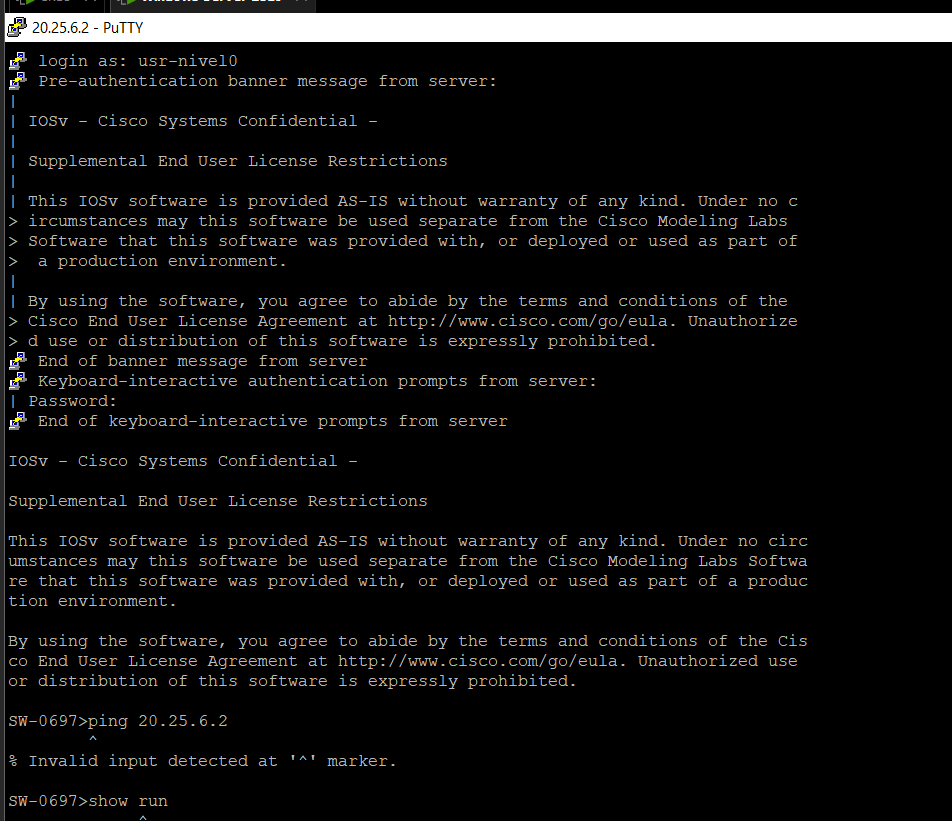

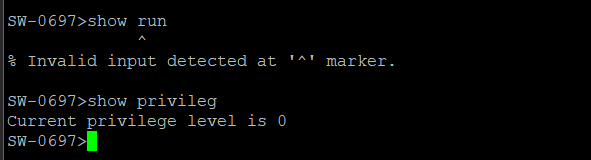

Tras `login as: usr-nivel0`, `ping 20.25.6.2` y `show run` devuelven *Invalid input detected* y `show privilege` confirma el nivel 0.

### T17 – nivel 5 (29-oct)
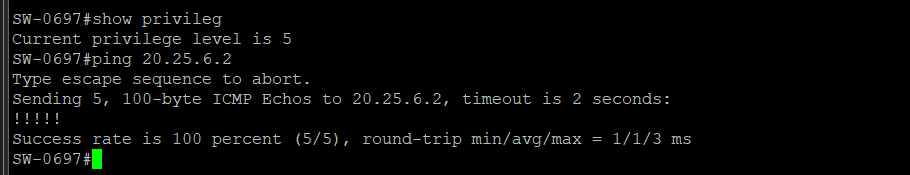

`show privilege` → nivel 5, prompt `SW-0697#`, y `ping 20.25.6.2` responde 5/5 (1/1/3 ms). **El inicio de sesión y la barra de título no son visibles**: por tratarse del nivel 5 corresponde a `usr-nivel5` (único miembro de `GRP-Nivel-5`), pero la cuenta no se ve en la captura. `20.25.6.2` es la IP del propio switch, por lo que la prueba demuestra que el comando está permitido, no la conectividad.

### T14 – `usr-nivel10` (28-oct)
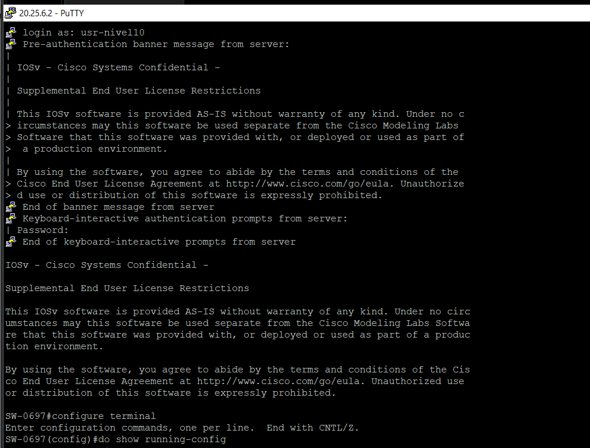

Prompt `SW-0697#` y `configure terminal` aceptado. Se escribió `do show running-config`, pero su salida no está en esta captura.

### T18 – inicio de sesión de `usr-nivel10` (29-oct)
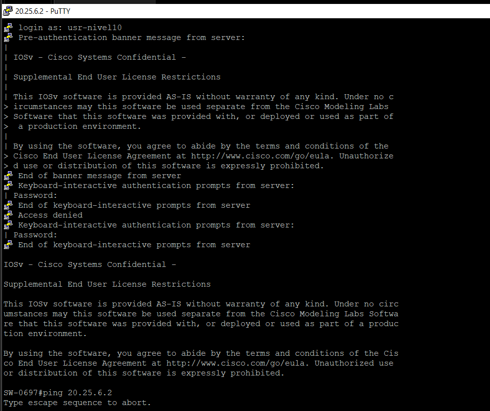

El primer intento termina en *Access denied* y PuTTY vuelve a pedir la contraseña; el segundo intento se acepta. **La causa del primer rechazo no está documentada.** Después se ejecuta `ping 20.25.6.2`.

### T19 – nivel 10: comandos (29-oct)
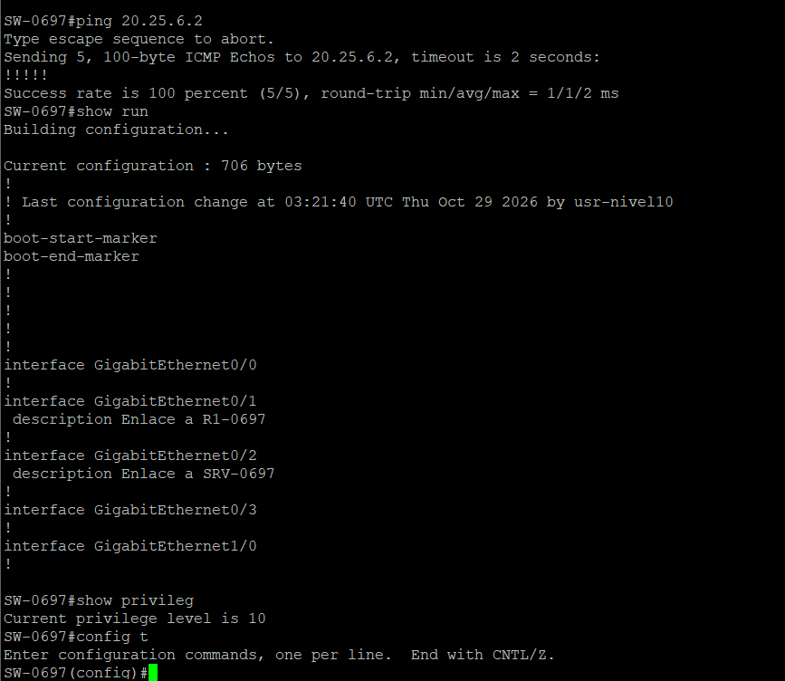

- `ping 20.25.6.2` → 5/5 (1/1/2 ms); el nivel 10 conserva el comando del nivel 5.
- `show run` → configuración **reducida de 706 bytes** (solo interfaces y descripciones), igual que el 28-oct, con *Last configuration change at 03:21:40 UTC Thu Oct 29 2026 by usr-nivel10*.
- `show privilege` → nivel 10; `config t` abre el modo de configuración.
- La captura no tiene barra de título ni línea de inicio de sesión.

### T15 – `show running-config` con nivel 10 (28-oct)
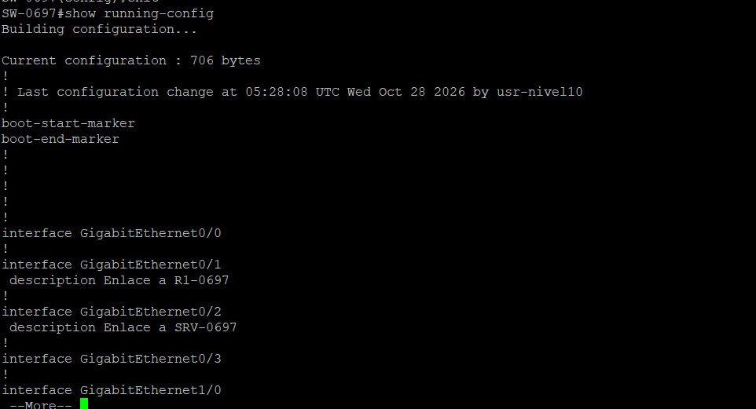

Configuración **reducida de 706 bytes**, frente a los 5810 bytes de la configuración completa.

### Otras evidencias

- `show ip ssh` (T8): SSH habilitado v2.0.
- `%SYS-5-CONFIG_I … by usr-nivel10 on console` (04:13:43 UTC del 28-oct): `usr-nivel10`, cuenta que solo existe en Active Directory, también abrió sesión por la **consola**.
- `show aaa servers` confirma que el switch autentica contra NPS (sección 7).
- El [`running-config` actual](../configs/switch/running-config.txt) es una recaptura del 29-oct-2026 con contenido idéntico al del 28-oct.

## 7. Contadores RADIUS (`show aaa servers`)

| Métrica | R1-0697 | SW-0697 |
|---|---|---|
| Servidor | 20.25.6.97, puertos 1812/1813 | 20.25.6.97, puertos 1812/1813 |
| Estado | *current UP* (2951 s) | *current UP* (3170 s) |
| Autenticación: solicitudes | 14 | 3 |
| Autenticación: accept / reject | 9 / 5 | 2 / 1 |
| Autenticación: timeouts | 0 | 0 |
| Autorización: solicitudes | 0 | 0 |
| *Accounting*: solicitudes | 30 | 16 |
| *Accounting*: start / stop | 9 / 8 | 2 / 1 |
| *Accounting*: timeouts / retransmisiones | 12 / 8 | 12 / 8 |
| *Accounting*: transacciones éxito / fallo | 18 / 4 | 4 / 4 |
| Contadores acumulados | 50 min | 54 min |

Observaciones:

- Los contadores se capturaron antes de las pruebas SSH al switch y pueden corresponder a la configuración anterior o a la actual de R1 (que luego cambió a un grupo de servidores nombrado).
- La autenticación contra NPS responde sin *timeouts* en ambos equipos.
- No hay solicitudes de **autorización** independientes (`Author request 0`) en ninguno; los niveles se aplicaron igualmente (T1–T3).
- El *accounting* muestra **12 timeouts, 8 retransmisiones y 4 transacciones fallidas en ambos equipos**. Que las cifras coincidan sugiere un evento común (por ejemplo, NPS detenido o puerto 1813 bloqueado), pero la causa no está confirmada. 

## 8. Registros de autenticación (`SEC_LOGIN`)

**R1-0697**

| Hora (UTC) | Usuario | Resultado |
|---|---|---|
| 03:32:24, 03:32:26, 03:32:28 | `unknown` | Fallo |
| 03:32:46, 03:34:29, 03:34:44 | `admin0697` | Fallo |
| 03:41:10 | `usr-nivel0` | Fallo |
| 03:41:18 | `usr-nivel0` | Éxito |

Los tres fallos de `admin0697` son coherentes con que NPS rechaza la cuenta (no existe en AD) y que IOS **no recurre al método local ante un rechazo**, solo si el servidor no responde. El respaldo local con NPS inaccesible **no se ha probado**.

**SW-0697:** 8 fallos entre 03:31:42 y 03:32:04 con el campo de usuario vacío; el filtro no muestra ninguna entrada de éxito.

> **Capturas incompletas:** en R1 no aparecen los éxitos de `usr-nivel5` (03:42:29) y `usr-nivel10` (03:44:07) que sí se ven en las capturas de consola, y en SW no aparece el inicio de sesión de `usr-nivel10`. Conviene repetir `show logging` completo justo después de las pruebas 

## 9. Matriz nivel ↔ resultado

**R1-0697 (consola y SSH)**

| Prueba | Nivel 0 | Nivel 5 | Nivel 10 |
|---|:--:|:--:|:--:|
| `show privilege` | 0 ✅ | 5 ✅ | 10 ✅ |
| `ping` | rechazado ✅ | 4/5 ✅ | — |
| `show running-config` | rechazado ✅ | rechazado ✅ | aceptado, salida reducida ✅ |
| `configure terminal` | — | rechazado ✅ | aceptado ✅ |
| `reload` / `debug` | — | — | rechazados ✅ |

**SW-0697 (SSH)**

| Prueba | Nivel 0 | Nivel 5 | Nivel 10 |
|---|:--:|:--:|:--:|
| `show privilege` | 0 ✅ | 5 ✅ | 10 ✅ |
| `ping` | rechazado ✅ | 5/5 ✅ (a la IP del propio switch) | 5/5 ✅ |
| `show running-config` | rechazado ✅ | sin prueba | aceptado, salida reducida ✅ |
| `configure terminal` | — | sin prueba | aceptado ✅ |
