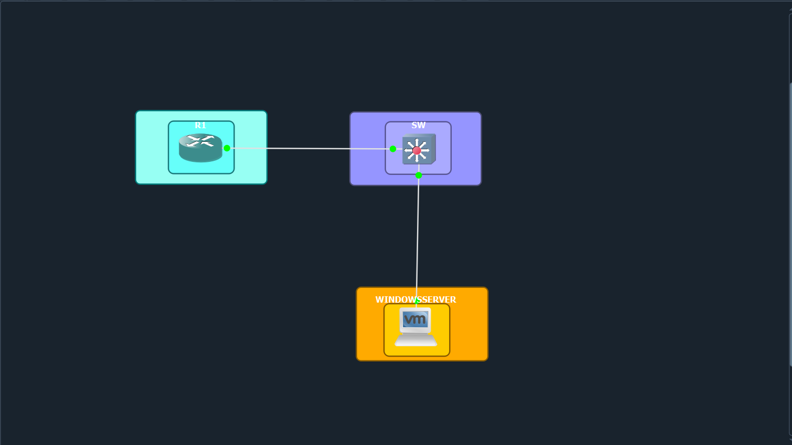

# Laboratorio de autenticación y autorización centralizada con RADIUS, NPS y Active Directory

Laboratorio de seguridad informática en el que un router y un switch Cisco IOS validan el acceso administrativo contra un servidor Windows con Active Directory y Network Policy Server (NPS), mediante RADIUS y niveles de privilegio 0, 5 y 10.

## 🎥 Demostración del laboratorio

[](https://www.youtube.com/watch?v=AUIDbIU_O54)

[Ver video demostrativo del laboratorio](https://www.youtube.com/watch?v=AUIDbIU_O54) · más información en [demo/README.md](demo/README.md)

---

## Descripción del proyecto

El router `R1-0697` y el switch `SW-0697` (Cisco IOS 15.2) son **clientes RADIUS** del servidor `SRV-0697` (Windows Server 2019), que ejecuta Active Directory (`lab0697.local`) y NPS. Las cuentas administrativas se organizan en tres grupos de seguridad (nivel 0, 5 y 10); NPS entrega a cada equipo el nivel de privilegio correspondiente al grupo del usuario, y cada nivel dispone de un conjunto distinto de comandos. Cada equipo conserva un usuario local como respaldo y ofrece acceso por SSH v2.

## Propósito del laboratorio

**Estudiar y documentar la autenticación y autorización centralizada mediante RADIUS y NPS, integrados con Active Directory, para el acceso administrativo a los dispositivos de red.**

## Objetivos

**General:** implementar y documentar AAA centralizado en un router y un switch Cisco IOS mediante RADIUS (NPS) y Active Directory, con autorización por niveles de privilegio.

**Específicos:**
1. Configurar el router y el switch como clientes RADIUS.
2. Crear un usuario local en cada equipo.
3. Aplicar autenticación, autorización y *accounting* con listas de métodos nombradas.
4. Habilitar registros de autenticación y de la actividad AAA/RADIUS.
5. Habilitar SSH v2 en ambos equipos.
6. Crear en Active Directory los grupos de nivel 0, 5 y 10.
7. Configurar NPS con los clientes RADIUS y una directiva de red por nivel.
8. Verificar cada nivel y documentar la evidencia.

## Tecnologías utilizadas

| Tecnología | Detalle |
|---|---|
| Cisco IOS 15.2 | Router y switch (imágenes IOSv) |
| Windows Server 2019 | Standard Evaluation, 10.0.17763 |
| Active Directory (AD DS) y DNS | Dominio `lab0697.local` |
| Network Policy Server (NPS) | Servidor RADIUS (UDP 1812/1813) |
| SSH v2, PuTTY | Acceso remoto y pruebas |
| Visor de eventos, PowerShell | Auditoría y verificación |
| Emulador | **[INFORMACIÓN PENDIENTE]** |

## Arquitectura del laboratorio



*Topología original: R1 ↔ SW ↔ servidor Windows. No se modificó. Diagrama lógico y plan de direccionamiento en [docs/03](docs/03-arquitectura.md).*

| Dispositivo | Interfaz | Dirección |
|---|---|---|
| R1-0697 | Gi1/0 | 20.25.6.1/24 |
| SW-0697 | Vlan97 | 20.25.6.2/24 (GW 20.25.6.1) |
| SRV-0697 | Ethernet0 2 | 20.25.6.97/24 (GW 20.25.6.1) |

## Componentes

- **Router R1-0697:** AAA con RADIUS (`GRP-NPS`), usuario local `admin0697`, `enable secret`, consola/auxiliar/VTY con NPS, SSH v2, niveles de privilegio. → [docs/04](docs/04-configuracion-router.md)
- **Switch SW-0697:** misma política AAA, VLAN 97 de gestión, SSH v2 con claves RSA, niveles de privilegio. → [docs/05](docs/05-configuracion-switch.md)
- **Servidor SRV-0697:** AD DS (grupos `GRP-Nivel-0/5/10` y usuarios `usr-nivel0/5/10`) y NPS (clientes RADIUS y directivas `POL-Nivel-0/5/10`). → [docs/06](docs/06-active-directory.md) y [docs/07](docs/07-configuracion-nps.md)

## Documentación técnica

| Documento | Contenido |
|---|---|
| [01 – Introducción](docs/01-introduccion.md) | Descripción, problema, propósito y tecnologías |
| [02 – Objetivos y alcance](docs/02-objetivos-y-alcance.md) | Objetivos y límites del laboratorio |
| [03 – Arquitectura](docs/03-arquitectura.md) | Topología, diagrama y direccionamiento |
| [04 – Router](docs/04-configuracion-router.md) | Configuración y niveles de privilegio |
| [05 – Switch](docs/05-configuracion-switch.md) | Configuración y estado de SSH |
| [06 – Active Directory](docs/06-active-directory.md) | Dominio, grupos y membresía |
| [07 – NPS y RADIUS](docs/07-configuracion-nps.md) | Clientes, directivas y flujo AAA |
| [08 – Pruebas y validación](docs/08-pruebas-y-validacion.md) | Pruebas, capturas y contadores |
| [09 – Resultados](docs/09-resultados.md) | Resultados demostrados y no demostrados |
| [10 – Problemas y pendientes](docs/10-problemas-y-soluciones.md) | Hallazgos H1–H15 y datos faltantes |
| [11 – Conclusiones](docs/11-conclusiones.md) | Conclusiones basadas en la evidencia |
| [12 – Estado e inventario](docs/12-estado-e-inventario.md) | Verificación final, inventario de archivos y aclaraciones |

## Configuraciones

- Router: [`configs/router/running-config.txt`](configs/router/running-config.txt) (y [versión inicial](configs/router/historial/running-config_v1-inicial.txt))
- Switch: [`configs/switch/running-config.txt`](configs/switch/running-config.txt) (y [versión inicial](configs/switch/historial/running-config_v1-inicial.txt))
- Servidor: [`configs/server/README.md`](configs/server/README.md)
- Scripts: según el autor, son los `running-config` anteriores ([`scripts/README.md`](scripts/README.md)).

Son copias **sanitizadas**: los hashes y la clave compartida RADIUS se sustituyeron por marcadores. Ver [`configs/README.md`](configs/README.md).

## Evidencias

| Carpeta | Contenido |
|---|---|
| [`diagrams/`](diagrams/) | Topología original |
| [`images/router/`](images/router/) | Pruebas por consola y SSH en R1 |
| [`images/switch/`](images/switch/) | Pruebas por SSH en SW |
| [`images/active-directory/`](images/active-directory/) | Usuarios, grupos y membresía |
| [`images/nps/`](images/nps/) | Clientes, directivas y eventos 6272 |
| [`images/servidor/`](images/servidor/) | IP y versión del servidor |
| [`evidence/ssh/`](evidence/ssh/) | `show ip ssh` (R1 y SW, antes y después) |
| [`evidence/radius-logs/`](evidence/radius-logs/) | `show logging` y `show aaa servers` |

La lista completa, con los nombres de archivo originales, está en [docs/12](docs/12-estado-e-inventario.md#inventario-de-materiales).

## Resultados

Resumen de lo **demostrado** (detalle en [docs/09](docs/09-resultados.md)):

- R1 aplica los niveles 0, 5 y 10 por consola y por SSH, y restringe los comandos de cada nivel.
- SW otorga los niveles 0, 5 y 10 por SSH y restringe `ping` y `show running-config` según el nivel.
- NPS autentica contra Active Directory, entrega `priv-lvl` según el grupo y registra eventos 6272.
- Ambos equipos muestran el servidor RADIUS en estado *UP*.

### ✅ Estado de cumplimiento de los requisitos

Leyenda: ✅ COMPLETADO · ⚠️ PARCIALMENTE COMPLETADO · ⏳ PENDIENTE

| Requisito | Estado | Evidencia / comentario |
|---|:--:|---|
| **Router** – AAA y niveles de privilegio | ✅ | Config, pruebas por consola y SSH, atributos `priv-lvl` en NPS |
| **Router** – RADIUS como cliente | ✅ | Config, cliente en NPS, eventos 6272, `show aaa servers` |
| **Router** – Usuario local | ✅ | `admin0697` (privilegio 15) |
| **Router** – Solo consola y auxiliar | ✅ | Consola y aux usan NPS; **VTY también** (H4) |
| **Router** – Logs de autenticación / autorización / RADIUS | ✅ | Autenticación y RADIUS evidenciados; sin solicitudes de autorización separadas; *accounting* con timeouts (H10) |
| **Router** – SSH | ✅ | `show ip ssh` y sesiones PuTTY |
| **Switch** – AAA y niveles de privilegio | ✅ | Niveles 0, 5 y 10 evidenciados por SSH (nivel 5: `show privilege` y `ping`) |
| **Switch** – RADIUS como cliente | ✅ | `show aaa servers`, cliente en NPS y sesiones con usuarios de AD |
| **Switch** – Usuario local | ✅ | `admin0697` (privilegio 15) |
| **Switch** – Solo consola y auxiliar | ✅ | `aux 0` usa NPS; VTY también (H4) |
| **Switch** – Logs | ✅ | Configurado; capturas incompletas (H11) |
| **Switch** – SSH | ✅ | `show ip ssh` habilitado y sesiones SSH |
| **AD** – Grupos nivel 0, 5 y 10 | ✅ | Grupos, membresía y ámbito de `GRP-Nivel-10` |
| **NPS** – Servicio y directivas | ✅ | Clientes y 3 directivas con grupo y `Cisco-AV-Pair`; faltan pestañas «Restricciones» e «Información general» |
| **Repo** – Video al inicio | ✅ | Enlace de YouTube al inicio del README ([demo/README.md](demo/README.md)) |
| **Repo** – Scripts utilizados | ✅ | Según el autor, los scripts son los `running-config` de R1 y SW ([scripts/](scripts/README.md)) |
| **Repo** – Running-configs | ✅ | Versión inicial y recaptura final del 29-oct, sanitizadas |
| **Repo** – Imágenes, diagramas y propósito | ✅ | 36 capturas, topología original y 3 diagramas Mermaid |

## Conclusiones

La evidencia demuestra que el router y el switch pueden autenticar a usuarios de Active Directory a través de NPS y que el nivel de privilegio, entregado mediante `Cisco-AV-Pair`, limita los comandos disponibles. Los tres niveles están verificados en el router y en el switch (en el switch, el nivel 5 solo con `show privilege` y `ping`). Quedan por cerrar el puerto auxiliar, el respaldo local, los *timeouts* de *accounting* y la confirmación de que la configuración está guardada. Ver [docs/11](docs/11-conclusiones.md) y [docs/10](docs/10-problemas-y-soluciones.md).

## Datos sensibles

No se publican contraseñas ni claves compartidas. Los marcadores `<HASH_SECRET_REDACTADO>` y `<RADIUS_SHARED_SECRET_REDACTADO>` sustituyen los valores reales; los originales se conservan fuera del repositorio.

## Estructura del repositorio

```text
.
├── README.md
├── CHANGELOG.md
├── docs/            # 01 a 12 (documentación técnica)
├── diagrams/        # topología original
├── images/          # capturas por componente
├── configs/         # running-config (router, switch) y notas del servidor
├── scripts/         # indica que los scripts son los running-config
├── evidence/        # salidas de texto (ssh, radius-logs)
└── demo/            # video demostrativo (pendiente)
```

## Autoría

| Dato | Valor |
|---|---|
| Autor/a | [Emely Carrasco] |
| Institución | [Itla] |
| Asignatura | [Fundamento de seguridad de redes] |
| Fecha de realización | [29/10/2026]  |
