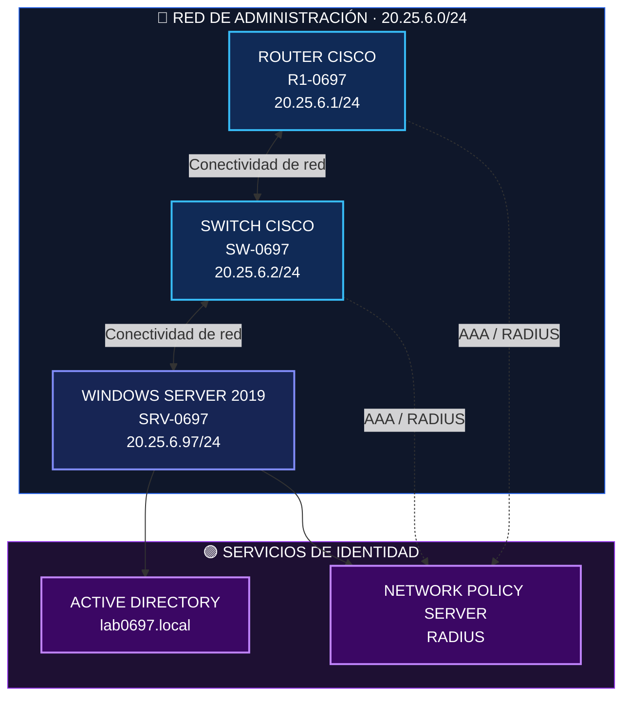
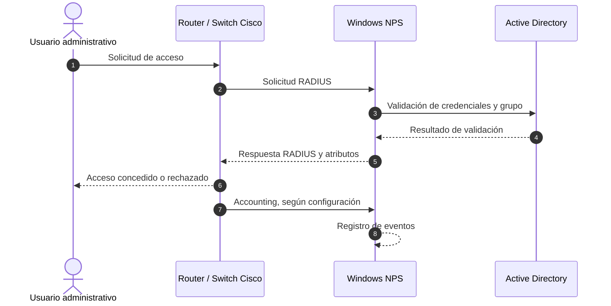
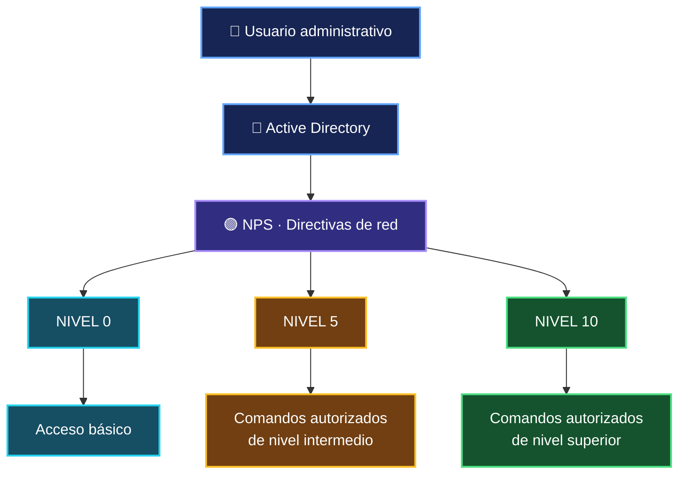

<div align="center">

# 🔐 AAA · RADIUS · NPS

### LABORATORIO DE SEGURIDAD INFORMÁTICA

**Autenticación · Autorización · Accounting**

Implementación de autenticación centralizada para dispositivos Cisco mediante Windows Server 2019, Active Directory y Network Policy Server.

<br>


<br><br>

<a href="https://www.youtube.com/watch?v=AUIDbIU_O54">

</a>

<br><br>

**EMELY CARRASCO · ITLA**

`Detect.` &nbsp; `Analyze.` &nbsp; `Document.`

</div>

---

## 📑 Índice

<table>
<tr>
<td width="50%" valign="top">

**🏗️ Arquitectura**
- [Propósito del laboratorio](#-propósito-del-laboratorio)
- [Tecnologías utilizadas](#️-tecnologías-utilizadas)
- [Arquitectura de red](#️-arquitectura-del-laboratorio)
- [Plan de direccionamiento](#-plan-de-direccionamiento-ip)
- [Flujo de autenticación AAA](#-flujo-de-autenticación-aaa)

</td>
<td width="50%" valign="top">

**🔐 Implementación**
- [Componentes](#-componentes-de-la-infraestructura)
- [Documentación técnica](#-documentación-técnica)
- [Configuraciones y scripts](#️-configuraciones-y-scripts)
- [Evidencias](#️-evidencias-del-laboratorio)
- [Resultados](#-resultados-y-validación)

</td>
</tr>
<tr>
<td valign="top">

**📚 Información adicional**
- [Estructura del repositorio](#-estructura-del-repositorio)
- [Consideraciones de seguridad](#-consideraciones-de-seguridad)

</td>
<td valign="top">

**👤 Proyecto**
- [Conclusiones](#-conclusiones)
- [Autoría](#-autoría)

</td>
</tr>
</table>

---

# 🎯 Propósito del laboratorio

Este laboratorio tiene como propósito implementar y documentar un sistema centralizado de **autenticación, autorización y registro de actividad (AAA)** utilizando RADIUS, Network Policy Server (NPS) y Active Directory.

La infraestructura permite que un router y un switch Cisco IOS validen el acceso administrativo contra un servidor Windows Server 2019. Los usuarios se organizan en grupos de seguridad con niveles de privilegio **0, 5 y 10**, de modo que sus permisos dependan del grupo al que pertenecen.

También se documentan el acceso mediante SSH v2, las cuentas locales de respaldo, los registros de autenticación y las pruebas realizadas.

### 🎯 Objetivos

- 🔹 Configurar el router y el switch como clientes RADIUS.
- 🔹 Crear usuarios locales de respaldo en los dispositivos de red.
- 🔹 Implementar autenticación, autorización y accounting mediante AAA.
- 🔹 Habilitar registros de autenticación y actividad AAA/RADIUS.
- 🔹 Configurar SSH v2 en ambos dispositivos.
- 🔹 Crear grupos de seguridad de nivel 0, 5 y 10 en Active Directory.
- 🔹 Configurar NPS con clientes RADIUS y directivas de red por nivel.
- 🔹 Verificar los privilegios y documentar los resultados obtenidos.

---

# 🛠️ Tecnologías utilizadas

| Tecnología | Aplicación en el laboratorio |
|---|---|
|  | Administración del router y switch |
|  | Plataforma del servidor |
|  | Gestión centralizada de identidades |
|  | Autenticación y autorización |
|  | Administración remota segura |
| DNS | Resolución de nombres del dominio |
| PuTTY | Pruebas de conexión SSH |
| Visor de eventos | Consulta de registros de autenticación |
| PowerShell | Verificación y consulta de información |
| Emulador | **[INFORMACIÓN PENDIENTE]** |

---

# 🏗️ Arquitectura del laboratorio

La infraestructura está compuesta por tres elementos principales: un router Cisco, un switch Cisco y un servidor Windows Server 2019 con Active Directory y NPS.

## 🖼️ Topología original

<div align="center">


*Topología original del laboratorio.*

</div>

## 🌐 Diagrama lógico de red



*Representación lógica de la infraestructura prevista. Las conexiones y el flujo RADIUS deben contrastarse con las pruebas de conectividad documentadas.*

## 📡 Plan de direccionamiento IP

| Dispositivo | Interfaz | Dirección IP | Función |
|---|---|---|---|
| R1-0697 | Gi1/0 | `20.25.6.1/24` | Router |
| SW-0697 | VLAN 97 | `20.25.6.2/24` | Gestión del switch |
| SRV-0697 | Ethernet0 2 | `20.25.6.97/24` | Servidor AD/NPS |

**Red de administración:** `20.25.6.0/24`

**Puerta de enlace:** `20.25.6.1`, según la configuración documentada del switch y del servidor.

📄 [Consultar la arquitectura completa](docs/03-arquitectura.md).

---

# 🔐 Flujo de autenticación AAA

AAA comprende tres funciones fundamentales para controlar el acceso administrativo.

<table>
<tr>
<td align="center" width="33%">


**Autenticación**

Verifica la identidad del usuario.

</td>
<td align="center" width="33%">


**Autorización**

Determina qué comandos y recursos puede utilizar.

</td>
<td align="center" width="33%">


**Registro**

Permite registrar información de las sesiones y la actividad administrativa.

</td>
</tr>
</table>

## 🔄 Diagrama del flujo AAA



> **Nota técnica:** el diagrama representa el flujo lógico esperado. La autorización efectiva y el registro de sesiones dependen de las directivas de NPS y de la configuración AAA aplicada a los dispositivos.

## 🛡️ Niveles de privilegio

Los grupos de Active Directory y las directivas de NPS permiten asociar los usuarios con diferentes niveles de privilegio.



Los permisos efectivos deben corresponder a los comandos configurados y verificados en cada dispositivo.

---

# 🧩 Componentes de la infraestructura

## 🔵 01 · Router R1-0697

Responsable del enrutamiento y del acceso administrativo al dispositivo.

- Configuración AAA con RADIUS mediante `GRP-NPS`.
- Usuario local `admin0697`.
- Configuración de `enable secret`.
- Autenticación en las líneas de consola, auxiliar y VTY.
- Acceso SSH v2.
- Niveles de privilegio.
- Registros de autenticación y actividad.

📄 **Documentación:** [Configuración del router](docs/04-configuracion-router.md).

## 🩵 02 · Switch SW-0697

Responsable de la conectividad de la infraestructura y de la administración de su interfaz de gestión.

- Configuración AAA y RADIUS.
- VLAN 97 para administración.
- Usuario local `admin0697`.
- Acceso SSH v2 y claves RSA.
- Niveles de privilegio.
- Registros de actividad.

📄 **Documentación:** [Configuración del switch](docs/05-configuracion-switch.md).

## 🟣 03 · Servidor SRV-0697

Windows Server 2019 centraliza la gestión de identidades y las políticas de acceso.

**Active Directory**

- Dominio `lab0697.local`.
- Grupos `GRP-Nivel-0`, `GRP-Nivel-5` y `GRP-Nivel-10`.
- Usuarios `usr-nivel0`, `usr-nivel5` y `usr-nivel10`.

**Network Policy Server**

- Clientes RADIUS para el router y el switch.
- Directivas `POL-Nivel-0`, `POL-Nivel-5` y `POL-Nivel-10`.
- Asignación de privilegios mediante `Cisco-AV-Pair`.
- Registros y evidencias de autenticación.

📄 **Documentación:** [Active Directory](docs/06-active-directory.md) · [Configuración de NPS](docs/07-configuracion-nps.md).

---

# 📚 Documentación técnica

La documentación se organiza por temas para facilitar la revisión del diseño, la implementación y las pruebas.

| N.º | Documento | Contenido |
|:---:|---|---|
|  | [Introducción](docs/01-introduccion.md) | Descripción, problema, propósito y tecnologías |
|  | [Objetivos y alcance](docs/02-objetivos-y-alcance.md) | Objetivos y límites del laboratorio |
|  | [Arquitectura](docs/03-arquitectura.md) | Topología, diagrama y direccionamiento |
|  | [Router](docs/04-configuracion-router.md) | Configuración y niveles de privilegio |
|  | [Switch](docs/05-configuracion-switch.md) | Configuración y estado de SSH |
|  | [Active Directory](docs/06-active-directory.md) | Dominio, grupos y membresía |
|  | [NPS y RADIUS](docs/07-configuracion-nps.md) | Clientes, directivas y flujo AAA |
|  | [Pruebas y validación](docs/08-pruebas-y-validacion.md) | Pruebas, capturas y contadores |
|  | [Resultados](docs/09-resultados.md) | Resultados demostrados y no demostrados |
|  | [Problemas y pendientes](docs/10-problemas-y-soluciones.md) | Hallazgos H1–H15 y datos faltantes |
|  | [Conclusiones](docs/11-conclusiones.md) | Conclusiones basadas en la evidencia |
|  | [Estado e inventario](docs/12-estado-e-inventario.md) | Verificación final e inventario de archivos |

---

# ⚙️ Configuraciones y scripts

El repositorio incluye las configuraciones documentadas de los dispositivos y los archivos asociados al laboratorio.

| Componente | Archivo |
|---|---|
| 🔵 Router | [`configs/router/running-config.txt`](configs/router/running-config.txt) |
| 🔵 Router · versión inicial | [`configs/router/historial/running-config_v1-inicial.txt`](configs/router/historial/running-config_v1-inicial.txt) |
| 🩵 Switch | [`configs/switch/running-config.txt`](configs/switch/running-config.txt) |
| 🩵 Switch · versión inicial | [`configs/switch/historial/running-config_v1-inicial.txt`](configs/switch/historial/running-config_v1-inicial.txt) |
| 🟣 Servidor | [`configs/server/README.md`](configs/server/README.md) |
| 🟢 Scripts y notas | [`scripts/README.md`](scripts/README.md) |
| 📁 Inventario de configuraciones | [`configs/README.md`](configs/README.md) |

Las configuraciones publicadas son copias sanitizadas. Los hashes y la clave compartida RADIUS se sustituyeron por marcadores.

---

# 🖼️ Evidencias del laboratorio

Las evidencias permiten revisar las configuraciones aplicadas y contrastarlas con los resultados de las pruebas.

| Carpeta | Contenido |
|---|---|
| 🗺️ [`diagrams/`](diagrams/) | Topología original |
| 🔵 [`images/router/`](images/router/) | Pruebas por consola y SSH en R1 |
| 🩵 [`images/switch/`](images/switch/) | Pruebas por SSH en SW |
| 🟣 [`images/active-directory/`](images/active-directory/) | Usuarios, grupos y membresía |
| 🟪 [`images/nps/`](images/nps/) | Clientes, directivas y eventos 6272 |
| 🖥️ [`images/servidor/`](images/servidor/) | IP y versión del servidor |
| 🔐 [`evidence/ssh/`](evidence/ssh/) | `show ip ssh` de R1 y SW, antes y después |
| 📋 [`evidence/radius-logs/`](evidence/radius-logs/) | `show logging` y `show aaa servers` |

El inventario completo, con los nombres originales de los archivos, está disponible en la [documentación del inventario](docs/12-estado-e-inventario.md#inventario-de-materiales).

---

# 🧪 Resultados y validación

Los siguientes resultados resumen las pruebas documentadas en el laboratorio.

## 📊 Resultados principales

- El router aplica los niveles 0, 5 y 10 por consola y SSH, y restringe los comandos de cada nivel.
- El switch otorga los niveles 0, 5 y 10 por SSH y restringe `ping` y `show running-config` según el nivel.
- NPS autentica contra Active Directory, entrega `priv-lvl` según el grupo y registra eventos 6272.
- Ambos equipos muestran el servidor RADIUS en estado *UP*.

## 🟢 Estado de cumplimiento de los requisitos

**Leyenda:**   

| Requisito | Estado | Evidencia o comentario |
|---|:---:|---|
| Router – AAA y niveles de privilegio | ✅ | Configuración, pruebas por consola y SSH, atributos `priv-lvl` en NPS |
| Router – RADIUS como cliente | ✅ | Configuración, cliente en NPS, eventos 6272, `show aaa servers` |
| Router – Usuario local | ✅ | `admin0697` (privilegio 15) |
| Router – Solo consola y auxiliar | ✅ | Consola y auxiliar usan NPS; VTY también (H4) |
| Router – Logs de autenticación, autorización y RADIUS | ✅ | Autenticación y RADIUS evidenciados; sin solicitudes de autorización separadas; accounting con timeouts (H10) |
| Router – SSH | ✅ | `show ip ssh` y sesiones PuTTY |
| Switch – AAA y niveles de privilegio | ✅ | Niveles 0, 5 y 10 evidenciados por SSH; nivel 5: `show privilege` y `ping` |
| Switch – RADIUS como cliente | ✅ | `show aaa servers`, cliente en NPS y sesiones con usuarios de AD |
| Switch – Usuario local | ✅ | `admin0697` (privilegio 15) |
| Switch – Solo consola y auxiliar | ✅ | `aux 0` usa NPS; VTY también (H4) |
| Switch – Logs | ✅ | Configurado; capturas incompletas (H11) |
| Switch – SSH | ✅ | `show ip ssh` habilitado y sesiones SSH |
| AD – Grupos de nivel 0, 5 y 10 | ✅ | Grupos, membresía y ámbito de `GRP-Nivel-10` |
| NPS – Servicio y directivas | ✅ | Clientes y tres directivas con grupo y `Cisco-AV-Pair`; faltan pestañas «Restricciones» e «Información general» |
| Repositorio – Video al inicio | ✅ | Enlace de YouTube al inicio del README |
| Repositorio – Scripts utilizados | ✅ | Según el autor, los scripts son los `running-config` de R1 y SW |
| Repositorio – Running-configs | ✅ | Versión inicial y recaptura final del 29 de octubre, sanitizadas |
| Repositorio – Imágenes, diagramas y propósito | ✅ | 36 capturas, topología original y tres diagramas Mermaid |

📄 [Consultar el detalle de los resultados](docs/09-resultados.md).

📄 [Revisar problemas y aspectos pendientes](docs/10-problemas-y-soluciones.md).

---

# 🔒 Consideraciones de seguridad

<div align="center">


</div>

- 🔐 No se publican contraseñas ni claves compartidas reales.
- 🛡️ Los marcadores `<HASH_SECRET_REDACTADO>` y `<RADIUS_SHARED_SECRET_REDACTADO>` sustituyen los valores reales.
- 📁 Los archivos publicados contienen copias sanitizadas de las configuraciones.
- 🔒 Los originales se conservan fuera del repositorio.

La documentación debe distinguir entre las funcionalidades implementadas, las pruebas que cuentan con evidencia y los aspectos que todavía necesitan revisión.

---

# 📂 Estructura del repositorio

```text
.
├── README.md
├── CHANGELOG.md
├── docs/
│   ├── 01-introduccion.md
│   ├── 02-objetivos-y-alcance.md
│   ├── 03-arquitectura.md
│   ├── 04-configuracion-router.md
│   ├── 05-configuracion-switch.md
│   ├── 06-active-directory.md
│   ├── 07-configuracion-nps.md
│   ├── 08-pruebas-y-validacion.md
│   ├── 09-resultados.md
│   ├── 10-problemas-y-soluciones.md
│   ├── 11-conclusiones.md
│   └── 12-estado-e-inventario.md
├── diagrams/
│   └── topologia-original.png
├── images/
│   ├── router/
│   ├── switch/
│   ├── active-directory/
│   ├── nps/
│   └── servidor/
├── configs/
│   ├── router/
│   ├── switch/
│   └── server/
├── scripts/
├── evidence/
│   ├── ssh/
│   └── radius-logs/
└── demo/
    └── README.md
```

📄 Para consultar el inventario detallado, visita [docs/12-estado-e-inventario.md](docs/12-estado-e-inventario.md).

---

# 📝 Conclusiones

La evidencia demuestra que el router y el switch pueden autenticar a usuarios de Active Directory mediante NPS y que el nivel de privilegio, entregado mediante `Cisco-AV-Pair`, limita los comandos disponibles.

Los tres niveles están verificados en el router y en el switch. En este último, el nivel 5 solo se verificó mediante `show privilege` y `ping`.

Quedan por cerrar el puerto auxiliar, el respaldo local, los timeouts de accounting y la confirmación de que la configuración está guardada.

<div align="center">

<a href="docs/11-conclusiones.md">

</a>

<a href="docs/10-problemas-y-soluciones.md">

</a>

</div>

---

# 👤 Autoría

<div align="center">

## Emely Carrasco

**Estudiante de Seguridad Informática · ITLA**


**Asignatura:** Fundamento de seguridad de redes

**Fecha de realización:** 29/10/2026

<br>

### `DETECT.` · `ANALYZE.` · `DOCUMENT.`

*Aprendiendo seguridad informática mediante la práctica, la documentación y la validación técnica.*

</div>
